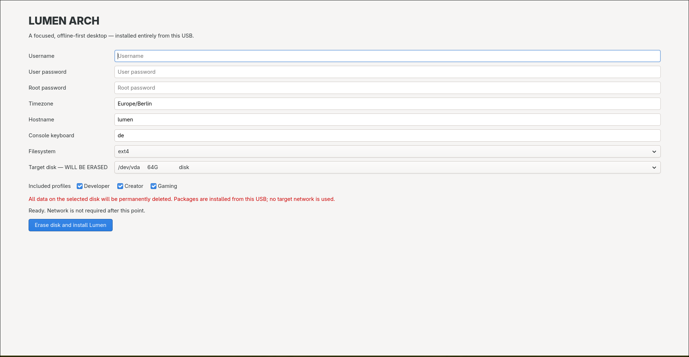
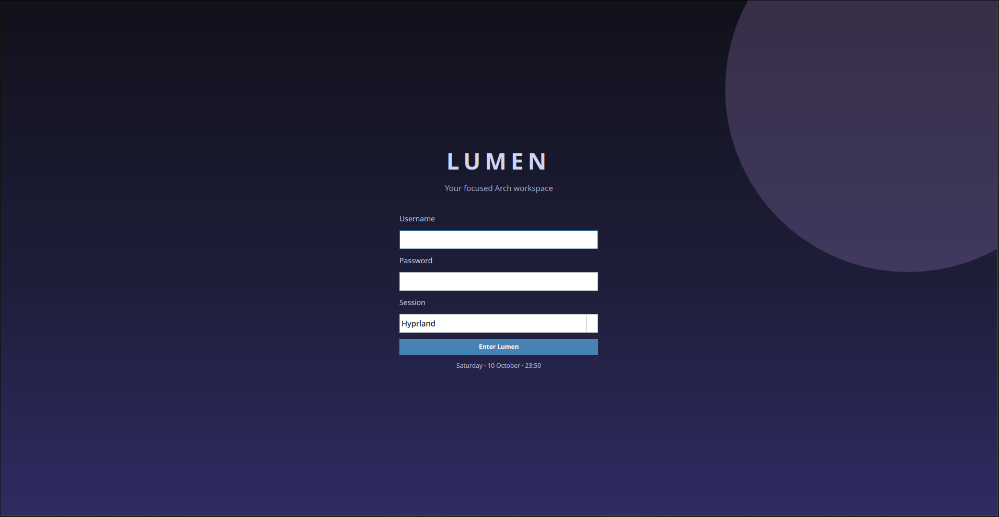
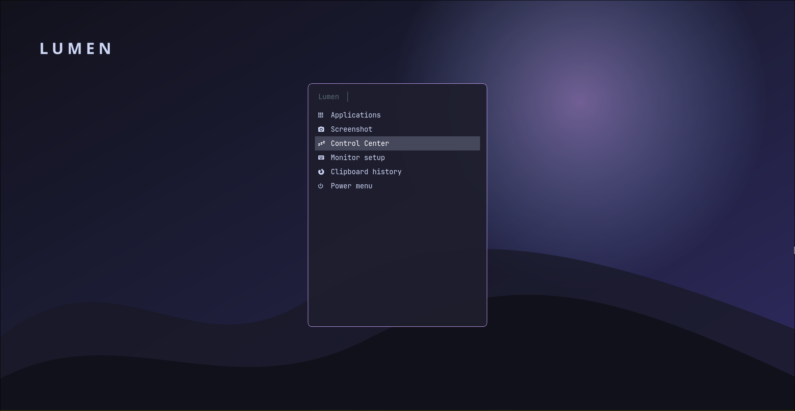
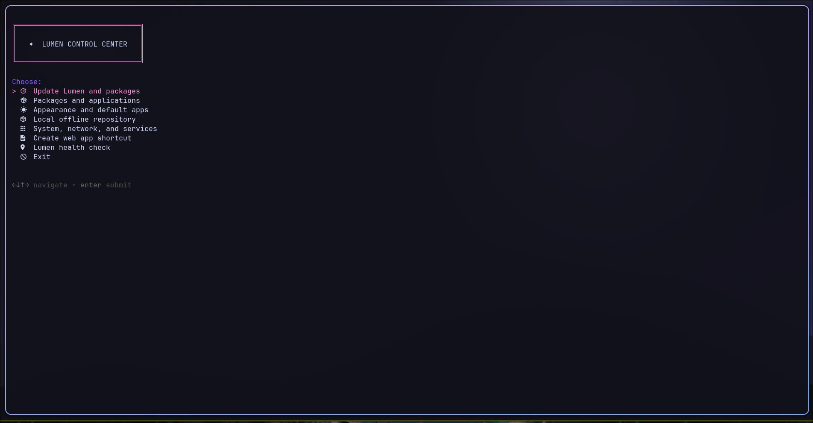
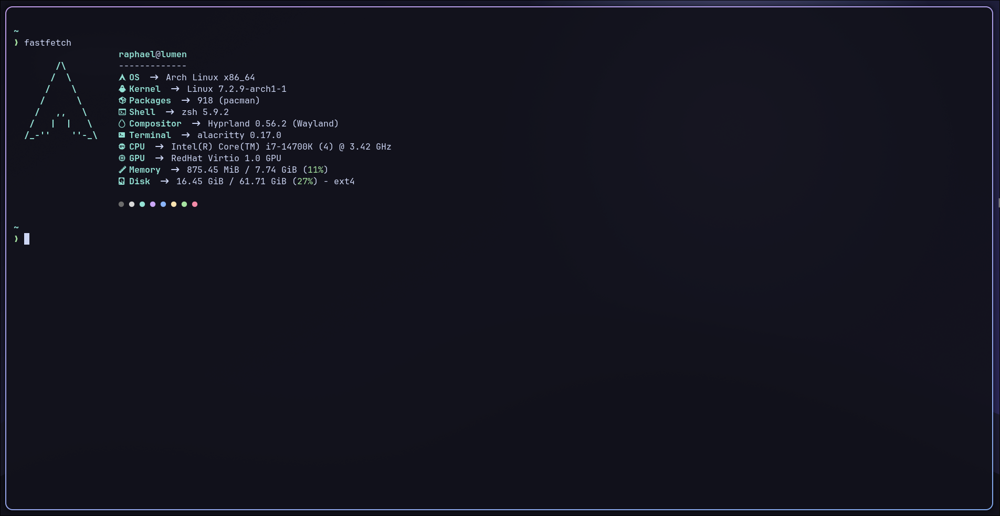

# Lumen Arch

Lumen Arch is a polished, offline-first Arch Linux desktop and installer ISO.
It provides a carefully integrated Hyprland environment while preserving the
things that make Arch useful: ordinary Pacman packages, readable configuration
files, no custom package manager, and the freedom to remove or add components.

The installation medium contains a complete local Pacman repository. A target
machine does **not** need an internet connection to install the kernel, drivers,
desktop, profiles, applications, and their transitive dependencies.

## Omarchy plugin

Lumen can also be added to an existing Omarchy 4 / Quattro desktop as a normal
bar-widget plugin. It does not replace Omarchy's shell, modify its keybinds,
install packages, or use `sudo`; it simply adds a Lumen icon which opens the
locally installed Lumen Control Center in the configured terminal.

```bash
omarchy plugin add https://github.com/rhantschk-cmyk/LumenArch.git --enable
omarchy plugin validate ~/.config/omarchy/plugins/rhantschk-cmyk.lumen
```

The widget is useful on a host where the Lumen CLI has already been installed.
If `lumen` is unavailable, clicking it shows a notification instead of making
any system changes. Omarchy plugins are unsandboxed QML code, so review the
repository before installing it.

### Using Omarchy widgets in Lumen

Lumen also supports the other direction: it can discover compatible Omarchy
**bar-widget** plugins and place enabled ones in the Lumen Quickshell bar. This
does not install Omarchy, start its shell, or make Lumen depend on it. Put a
plugin in Omarchy's normal user-plugin location (for example by cloning it)
and enable it from Lumen:

```bash
git clone <plugin-repository> ~/.config/omarchy/plugins/<plugin-id>
lumen omarchy list
lumen omarchy enable <plugin-id>
```

`lumen omarchy disable <plugin-id>` hides a widget without deleting or
modifying its files. The bar refreshes its enabled-widget list automatically
within a few seconds.

This is intentionally an ABI compatibility layer, not a claim that every
Omarchy plugin can run everywhere: supported plugins must declare the
`bar-widget` kind and use its public `BarWidget` / `WidgetButton` API (including
the injected `bar`, `moduleName`, and `settings` properties). Plugins requiring
Omarchy's private shell APIs, panels, overlays, menus, services, or a complete
replacement bar are not supported. Like all QML shell extensions, imported
widgets run with the desktop user's permissions; only enable sources you trust.

> **Status and safety:** Lumen currently targets UEFI systems and deliberately
> erases the complete selected disk. ext4 and Btrfs are supported. The guided
> installer enables LUKS2 encryption of the system partition by default; the
> small UEFI boot partition necessarily remains unencrypted. Dual boot and
> preserving an existing installation are not implemented.

## What is included

The standard installation enables every optional profile by default, so the
first boot is productive rather than a blank desktop.

| Area | Included tools |
| --- | --- |
| Session | Hyprland (Lua configuration), Quickshell panel, SDDM, Hyprlock, Hypridle, Polkit, portals and notifications |
| Connectivity | NetworkManager, Bluetooth, PipeWire/WirePlumber, screen-sharing portals and `nmcli` |
| Everyday desktop | Firefox, Thunar, Fuzzel, screenshots with Grim/Slurp, clipboard history with Cliphist, Pavucontrol and GParted |
| Development | Git, Neovim, Tmux, LazyGit, LazyDocker, Docker, Podman, Go, Node.js, Python, Rust, Java, CMake and Kubernetes tooling |
| Creation | OBS Studio, Obsidian, Typora, MPV, Evince, ImageMagick and FFmpeg |
| Gaming | Steam, GameMode and MangoHud |
| Terminal workflow | Zsh, Spaceship/Starship, Zoxide, Eza, Bat, FZF, Fastfetch and Btop |
| Hardware | Intel/AMD Mesa and Vulkan packages, NVIDIA Open driver packages, microcode and common firmware |

Base and Desktop are always installed. Developer, Creator, and Gaming can be
deselected in the installer when a smaller initial system is preferred.

## Screenshots

| Offline graphical installer | Qt6 SDDM login |
| --- | --- |
|  |  |

| Launcher and desktop | Control Center |
| --- | --- |
|  |  |

| Terminal workflow |
| --- |
|  |

## Install from USB

1. Build or download the ISO and flash it to the **whole** USB device. Never
   write it to a partition such as `/dev/sdX1`.

   ```bash
   sudo dd if=build/iso/lumen-arch-YYYY.MM.DD-x86_64.iso of=/dev/sdX \
     bs=4M conv=fsync status=progress
   ```

2. Boot the USB in UEFI mode. At the boot menu, select **Launch Lumen
   Installer** (shown by the ISO as **Start Lumen Arch Installer**). Do not
   continue with the ArchISO entry that is selected by default: that entry is
   the plain live environment for manual installation and does not launch the
   graphical installer.

3. In the installer, choose a username and passwords, timezone, hostname,
   keyboard layout, filesystem, target disk, and optional profiles. The
   Developer, Creator, and Gaming profiles are initially selected. **Full-disk
   encryption** is also selected by default: enter and retain its separate
   LUKS2 passphrase. It encrypts all system data; only the required EFI System
   Partition is left readable for UEFI firmware and systemd-boot. You can turn
   it off before installing if you deliberately want an unencrypted system.

4. Confirm the destructive disk operation. After installation, remove the USB
   drive and reboot. SDDM starts the Lumen Hyprland session.

5. Press ``SUPER + U`` for the Control-Center and update your System, for the case there is
   an update availale

The installer packages the system exclusively from the USB's local repository;
target networking is not used. Internet can be configured after the first boot.

## Manual offline installation and custom package selection

Lumen is intentionally usable without the guided installer. This is for people
who want a leaner Arch installation, a custom partition layout, or complete
control over which parts some would call “bloat” are installed.

Boot the regular ArchISO live entry instead of **Launch Lumen Installer**. The
same ISO still exposes all Lumen package archives and manifests locally:

- local repository: `/opt/lumen/offline/repo`
- offline Pacman configuration: `/opt/lumen/offline/pacman.conf`
- package manifests: `/opt/lumen/profiles/*/packages.pacman`
- installer implementation: `/usr/local/bin/lumen-offline-install`

After you have partitioned and mounted a target at `/mnt`, you can bootstrap
only the packages you choose. For example, this installs a small bootable base
without a desktop profile:

```bash
pacstrap -G -C /opt/lumen/offline/pacman.conf /mnt \
  base linux linux-firmware networkmanager sudo systemd zsh
cp -a /opt/lumen /mnt/opt/lumen
```

Then configure fstab, locale, users, bootloader, and networking as you would on
normal Arch Linux. Before using Pacman in the installed system, initialise its
normal Arch keyring and restore the standard target configuration:

```bash
arch-chroot /mnt
pacman-key --init
pacman-key --populate archlinux
install -Dm644 /opt/lumen/offline/target-pacman.conf /etc/pacman.conf
```

While working from the USB, install any additional package available on the
medium with the same offline configuration, for example:

```bash
pacman -S --config /opt/lumen/offline/pacman.conf hyprland firefox neovim
```

Read the profile manifests to compose your own system: Base and Desktop contain
the platform and session, while Developer, Creator, and Gaming are independent
application collections. The ISO includes their full dependency closure, so
selecting individual packages from those manifests remains offline. Manual
installs are intentionally advanced: Lumen's graphical installer is the
supported path for a complete configured desktop.

## Desktop and shortcuts

The default session is Hyprland. Its configuration is ordinary Lua at
`~/.config/hypr/hyprland.lua`; user-facing Lumen scripts live in
`~/.config/lumen/`.

| Action | Shortcut |
| --- | --- |
| Terminal | `Super + Return` |
| App launcher | `Super + Space` |
| File manager | `Super + E` |
| Firefox | `Super + B` |
| Close / fullscreen / float | `Super + Q` / `Super + F` / `Super + Shift + F` |
| Full / region screenshot | `Print` / `Super + Print` |
| Screenshot menu | `Super + S` |
| Copy selected text / paste latest clipboard item / clipboard history | `Super + C` / `Super + V` / `Super + Shift + V` |
| Notification Center | `Super + Shift + N` or the bell in the top bar |
| Lock | `Super + Shift + L` |
| Power menu | `Super + Escape` |
| OBS Studio | `Super + O` |
| Neovim / Tmux / LazyGit | `Super + N` / `Super + T` / `Super + G` |
| Obsidian / Typora | `Super + M` / `Super + Shift + M` |
| Control Center | `Super + U` |
| LazyDocker | `Super + D` |
| HyprMon monitor setup | `Super + ,` |

The terminal launches Zsh. `cd` uses Zoxide (`z`), `ls` uses Eza, and `cat`
uses Bat. Run `fastfetch` for the Lumen system card.

The Quickshell top bar displays monitor-local Hyprland workspaces (click one
to activate it), CPU and RAM usage, the clock, notifications, and tray icons.

Neovim starts with a small, normal user configuration at
`~/.config/nvim/` that bootstraps LazyVim. Lazy.nvim owns its plugin checkout
and performs the initial plugin installation when Neovim is first started with
internet access; Lumen does not vendor a second plugin manager or overwrite its
state.

## Control Center

Open the terminal-based Control Center with `Super + U` or `lumenctl`. It is a
front end for common maintenance tasks without hiding the underlying Arch
commands.

- **Update Lumen and packages** clones or fast-forwards the official Lumen
  repository, installs updated user configuration, updates Pacman/Yay packages,
  and can apply changed system files and package requirements.
- **Packages and applications** can fuzzy-search official repositories or the
  AUR, inspect packages, remove installed packages, and install a curated set
  of optional applications. Installation is delegated to `lumen install`, so a
  failed package reports its error and returns to the menu instead of closing
  the Control Center.
- **Create web app shortcut** creates a named Firefox launcher in
  `~/.local/share/applications/` from a name and HTTPS/HTTP URL.
- **Connect to Wi-Fi** lists visible networks with `nmcli`, prompts for a
  password when needed, and creates a normal NetworkManager connection.
- **Appearance and default apps** applies a real GTK/portal light or dark
  preference and assigns browser, editor, and file-manager MIME defaults.
- **Local offline repository** mirrors downloaded Pacman archives, lets you
  add an archive or named package, exclude an archive from the local mirror,
  and retain a compact number of older versions.
- **Configure monitors**, **LazyDocker**, cache cleanup, service control, and
  system overview remain available from the same menu.

LazyDocker is deliberately run as the normal user, never through `sudo`. The
installer adds the user to the `docker` group and enables Docker; a logout and
login is required before a newly added group becomes active.

## Lumen CLI and local package archive

`lumen` is the documented command-line interface behind the Control Center.
Run `lumen help` or a command's `--help` for a concise command reference.

```bash
lumen center                         # open the terminal Control Center
lumen update                         # update Lumen and installed packages
lumen search --select hypr           # choose an official package with FZF
lumen search --aur --select theme    # choose an AUR package with FZF
lumen install <package>              # official package, then Yay fallback
lumen appearance dark
lumen default set browser firefox.desktop
lumen shell jq                       # temporary CLI environment; exit removes it
lumen project init . --name demo --description "Example project"
lumen snapshot all create --name before-upgrade
```

Lumen's package archive has a deliberate split between settings and data:

- `/etc/lumen/` contains human-readable repository settings, explicit package
  exclusions, and update holds.
- `/var/lib/lumen/repo/` contains downloaded package archives and the generated
  Pacman repository database. It can grow large and is safe to rebuild from
  Pacman's cache.

The `lumen-repo-sync` Pacman hook mirrors installed or updated package archives
into that repository. It is a normal local Pacman source, so packages can be
installed later without re-downloading them when the archive is present.

### How the local repository works

The local repository is intentionally empty on a fresh installation: the ISO's
archives stay on the installation medium instead of silently consuming disk
space on the new system. Create the initial local database from Pacman's cache
once:

```bash
lumen repo status
lumen repo sync
lumen repo list
```

You do **not** need to run `lumen repo add` for every package. After the first
sync, each normal Pacman install or upgrade downloads an archive into Pacman's
cache and Lumen's post-transaction hook automatically mirrors it into
`/var/lib/lumen/repo/`. It is then available for a future local/offline Pacman
installation. Run `lumen repo sync` again only to import archives that were
already in the cache or after manually changing that cache.

`lumen repo add` is for deliberate preloading: it downloads an official package
without installing it, or accepts the path to an existing archive. For example,
preload Firefox before travelling, or retain an AUR package that Yay has
already built:

```bash
lumen repo add firefox
lumen repo add /path/to/custom-package.pkg.tar.zst
```

If the initial sync reports no archives, the system's Pacman cache is empty.
That is valid; install or add a package while online to seed the repository.
Use `lumen repo prune` periodically to retain two archive versions per package
instead of allowing the local offline archive to grow without limit.

```bash
lumen repo status
lumen repo exclusions
lumen repo sync
lumen repo add firefox               # download once, retain in the local repo
lumen repo add /path/to/package.pkg.tar.zst
lumen repo exclude linux-firmware    # do not retain this archive locally
lumen repo unexclude linux-firmware
lumen repo prune                     # retain two local versions per package
lumen package hold linux             # exclude from normal Pacman updates
lumen package unhold linux
```

`repo exclude` controls only whether an archive is kept in Lumen's local
offline mirror. `package hold` writes an explicit Pacman `IgnorePkg` entry and
controls updates. The two operations are intentionally separate.

`lumen repo unexclude <package>` permits the package to be mirrored again, but
does not recreate an archive that was removed by `exclude`. Run `lumen repo add
<package>` (or install/update the package normally) to fetch it again.

### Local snapshots

`lumen snapshot` creates versioned, local recovery points under
`/var/lib/lumen/snapshots/`. It has five independently managed targets:

- `packages` records the installed package set. Restoring it installs missing
  saved official packages but deliberately does not remove packages added
  afterwards.
- `environment` archives Lumen's system settings and the invoking user's
  Lumen/desktop configuration.
- `repo` archives the complete local package repository, including its package
  archives.
- `dir` archives one explicitly selected directory.
- `all` combines the package manifest, environment, and local repository.

Every target accepts the same actions: `create`, `list`, `restore`, `clear`,
and `update`. `restore` is deliberately explicit and creates an automatic
pre-restore snapshot before it changes anything. It therefore requires
`--yes`.

```bash
# Name and inspect an all-system recovery point.
lumen snapshot all create --name before-upgrade
lumen snapshot all list

# Restore it. This creates an automatic "auto-before-…" safety snapshot first.
lumen snapshot all restore 20261013T120000Z-before-upgrade --yes

# Keep only the three newest snapshots of this target.
lumen snapshot all clear --keep 3

# Make a fresh successor of an existing snapshot.
lumen snapshot all update 20261013T120000Z-before-upgrade --name refreshed

# Preserve a project directory, then restore it at its original path or a
# different empty/existing directory.
lumen snapshot dir create ~/code/demo --name working-tree
lumen snapshot dir list
lumen snapshot dir restore 20261013T120000Z-working-tree --yes
lumen snapshot dir restore 20261013T120000Z-working-tree --target ~/tmp/demo-copy --yes
```

Use `lumen snapshot <target> --help` for the exact syntax. Snapshots are local
archives, not a replacement for backups on separate storage. In particular,
`environment`, `repo`, and `all` can consume substantial disk space; use
`clear --keep NUMBER` once older recovery points are no longer needed.

### Temporary package shells

> **Beta feature:** Temporary package shells are currently intended for
> command-line and development tools. They do **not** support graphical
> applications, nor do they forward Wayland, X11, D-Bus, audio, or other host
> desktop services into the environment.

`lumen shell <package>` provides a disposable, command-line package environment
similar in spirit to `nix-shell`, without installing that package on the host
system. It starts an isolated Arch root using only the package archives stored
by Lumen. Every shell includes Bash, Coreutils (`cat`, `ls`, `mkdir`, …) and
Vim in addition to the requested package. Leaving with `exit` deletes the
environment completely.

```bash
lumen repo add jq        # optional: preload a package while online
lumen shell jq
# (lumen:jq) root@lumen:/# jq --version
# (lumen:jq) root@lumen:/# exit
```

For a project shell, mount a directory with `--dir`. The shell starts in
`/workspace`; files from that directory are available there and changes are
written straight back to the host with your normal user ownership:

```bash
cd ~/code/my-rust-project
lumen shell cargo --dir .
# /workspace $ cargo build
# /workspace $ vim src/main.rs
```

Only the selected directory is shared. The rest of the shell remains
ephemeral, and no requested package is installed on the host. Treat the
workspace as normal host data: deleting or editing it in the shell changes it
for real.

If the package and all of its dependencies are already in the local archive,
the shell starts fully offline. When something is missing, Lumen downloads the
official package closure into `/var/lib/lumen/repo/` first, but never installs
it on the host. The root filesystem exists only until `exit`; package archives
remain in the local repository for the next shell.

## Reproducible coding projects

Lumen projects combine a project-local `project.lumen` manifest with a
system-wide registry and immutable local snapshots. They deliberately
complement Git rather than replacing it: use Git for collaboration and history;
use Lumen snapshots to preserve a working tree **and** the exact local package
environment that built it.

Create a project in an existing or new directory:

```bash
mkdir -p ~/code/example
cd ~/code/example
lumen project init . --name example --description "Example Rust project"
```

This writes `project.lumen`, registers the project under
`/var/lib/lumen/projects/`, and leaves source files in their original location.
The generated manifest is TOML and intentionally small:

```toml
[Init]
Name = "example"
Description = "Example Rust project"

[Environment]
Packages = ["rust", "cargo"]
Workspace = "."
Exec = "cargo run"
Compile = "cargo build --release"
Mode = "shell" # shell (default) or host

[Versions]
Path = ".lumen/versions"
CompileBeforeSaving = true
Exclude = [".git", "target", "node_modules", ".lumen"]
```

`Init.Name`, `Init.Description`, `Packages`, `Workspace`, `Exec`, and `Compile`
are required; `Mode` defaults to `shell`. Package names must be official Pacman package names. `Workspace` and snapshot
exclusions are relative to the project and may not escape it. `Mode = "shell"`
is the default and runs commands in an ephemeral Lumen environment; choose
`host` only when a command intentionally needs installed host tools.

Use the project from its directory, or name it explicitly:

```bash
lumen project status
lumen project prepare                # resolve package closure into the local repo
lumen project shell                  # open the declared environment at /workspace
lumen project compile
lumen project run
lumen project save --label "first working build"
lumen project versions
lumen project example --run
lumen project example --run --version v000001
```

The shell shortcut is equivalent and registers the manifest if necessary:

```bash
lumen shell --dir . --config project.lumen
```

Every `prepare`, `run`, `compile`, and `save` resolves the environment from
the local repository first. Lumen creates a lock containing the exact package
versions, archive names, and SHA-256 checksums. Missing archives are downloaded
into `/var/lib/lumen/repo/` but are never installed on the host merely for a
project environment.

`save` optionally compiles first, stores a `.tar.zst` source snapshot, saves
the matching manifest and package lock, and returns a version such as
`v000001`. When the workspace is a Git checkout, its commit, branch, and dirty
state are recorded with the snapshot. Restore is intentionally explicit and first snapshots the current
working tree:

```bash
lumen project restore --version v000001 --yes
lumen project diff v000001 v000002
lumen project example --run --version v000001  # source and package lock
```

Saved snapshot locks protect their package archives: `lumen repo prune` retains
them, and `lumen repo exclude <package>` refuses to remove a package required
by a saved project version. `lumen project remove NAME --yes` removes only
Lumen's metadata and snapshots; it never deletes your actual source directory.

## Build in a container

The supported build path uses a privileged Arch Linux container. It works on
any Linux host with Docker because ArchISO needs mount and loop-device access.

```bash
cd ~/Projekte/Distro/lumen-arch
sudo -v
./scripts/build-iso-container.sh
```

The resulting image is written to `build/iso/`. The following persistent caches
make repeat builds and recovery after a failed build much faster:

- `build/container-pacman-cache/` — official Arch package archives
- `build/offline-package-cache/` — archives embedded in Lumen's local repo
- `build/aur-package-cache/` — completed AUR package archives
- `build/offline-checkpoint/` — verified, complete package closure

Do not delete these directories unless a fresh package download is wanted; do
not commit `build/`.

### Resumable builds

Once the dependency stage succeeds, Lumen stores a verified offline package
checkpoint. Changes limited to the installer, documentation, theme, or user
configuration reuse it automatically and skip full dependency resolution and
AUR builds. Package manifest changes only fetch what is missing from the caches
when possible.

Force a complete dependency-stage rebuild:

```bash
LUMEN_REBUILD_PACKAGES=1 ./scripts/build-iso-container.sh
```

Refresh the Arch build container intentionally:

```bash
LUMEN_REFRESH_BUILDER=1 ./scripts/build-iso-container.sh
```

## Test in QEMU

The test helper boots the newest ISO with UEFI firmware and a persistent 64 GB
virtual disk:

```bash
./scripts/run-qemu.sh
```

Use another directory for a clean test disk:

```bash
LUMEN_VM_DIR="$HOME/VMs/lumen-test-clean" ./scripts/run-qemu.sh
```

For fast installer and live-session iteration, build a small non-installable
preview ISO instead of the complete offline repository:

```bash
LUMEN_DEV_ISO=1 ./scripts/build-iso-container.sh
LUMEN_ISO_DIR="$PWD/build/iso-dev" LUMEN_VM_DIR="$HOME/VMs/lumen-dev" \
  ./scripts/run-qemu.sh
```

## Project layout

- `profiles/base/`, `profiles/desktop/` — required system and desktop packages
- `profiles/developer/`, `creator/`, `gaming/` — optional profile manifests
- `profiles/installer/` — live-environment runtime packages
- `iso/` — ArchISO overlay, boot entry, service, and installer
- `home/` — files copied into the installed user's home directory
- `system/` — system-wide files such as the SDDM theme
- `scripts/` — build, validation, installation, and QEMU helpers
- `docs/` — architecture and customization reference

See [docs/architecture.md](docs/architecture.md) and
[docs/customization.md](docs/customization.md) for implementation details and
post-install customization.
